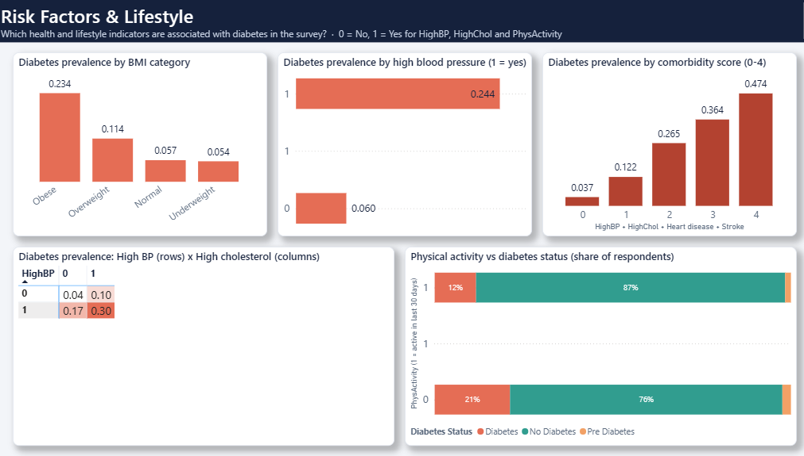
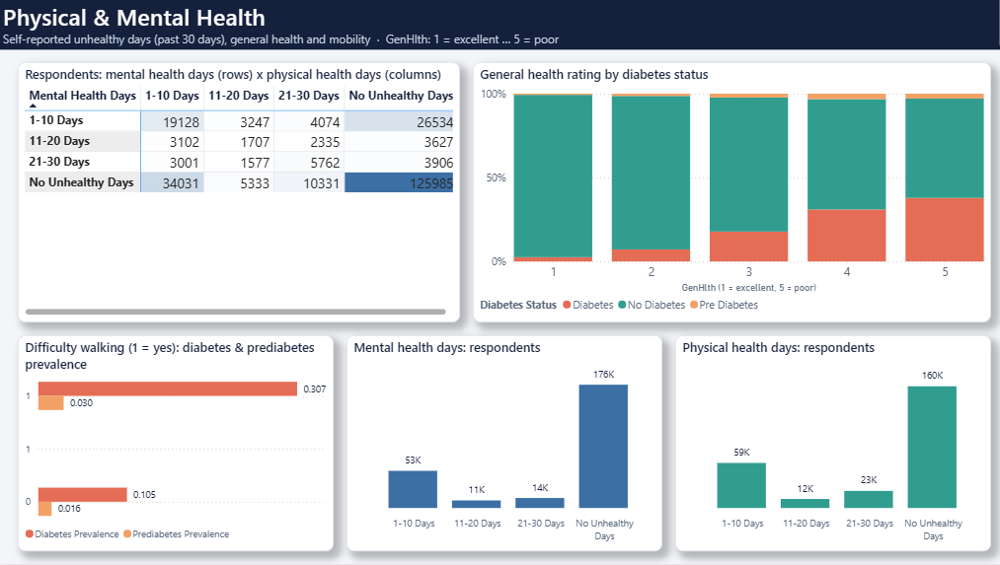
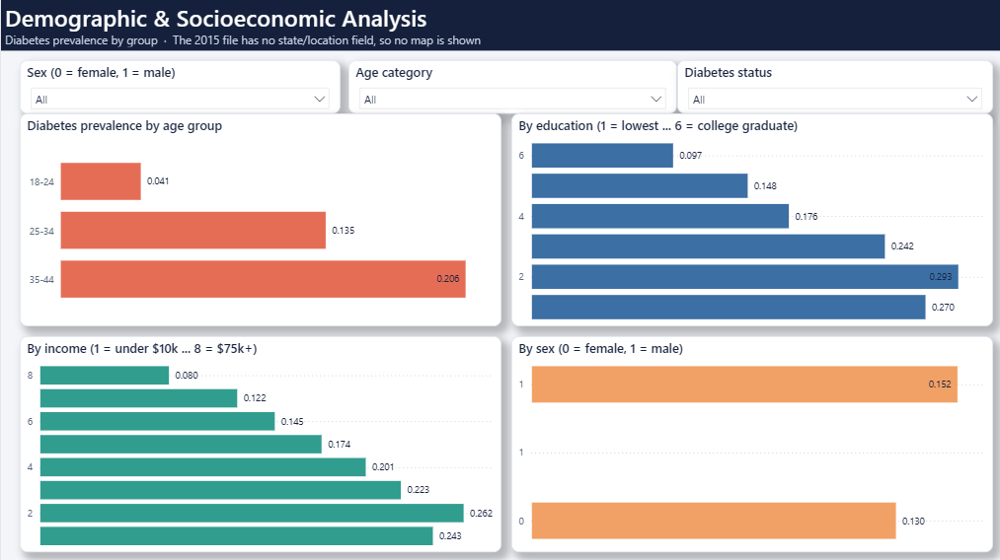

# Diabetes Health Indicators: BRFSS 2015

Exploratory analysis, feature engineering, predictive modelling and a Power BI dashboard built on the CDC's 2015 Behavioral Risk Factor Surveillance System (BRFSS) survey, with diabetes status as the target.

## Contents

- [Data](#data)
- [Project workflow](#project-workflow)
- [Exploratory findings](#exploratory-findings)
- [Power BI dashboard](#power-bi-dashboard)
- [Model results](#model-results)
- [Requirements](#requirements)

## Data

| | |
|---|---|
| File | `diabetes_012_health_indicators_BRFSS2015.csv` (253,680 respondents, 22 columns) |
| Target | `Diabetes_012`: 0 = no diabetes, 1 = prediabetes, 2 = diabetes (also used as `Diabetes_binary`) |
| Source | [CDC BRFSS 2015 annual data](https://www.cdc.gov/brfss/annual_data/annual_2015.html) |
| Codebook | [BRFSS 2015 codebook (PDF)](https://www.cdc.gov/brfss/annual_data/2015/pdf/codebook15_llcp.pdf) |

The classes are heavily imbalanced (about 84% no diabetes, 14% diabetes, 2% prediabetes), which shapes both the modelling and how results are read. The file has no state or location field, so no geographic analysis is possible.

## Project workflow

**1. Data collection**
- Pulled the BRFSS 2015 diabetes indicators dataset and documented each column and its meaning.

**2. Exploration and preprocessing**
- Checked missing values (counts and percentages) and unique values per column.
- Identified the class imbalance in the target.
- Dropped columns judged irrelevant: `AnyHealthcare`, `NoDocbcCost`.
- Removed low-variance features with `VarianceThreshold`.

**3. Feature engineering**
- `ComorbidityScore`: aggregate of comorbid conditions.
- `GeneralHealthScore`: combined mental, physical and general health.
- `DietQuality`: fruit and vegetable intake combined.
- `BMI_Category`: underweight, normal, overweight, obese.
- `MentHlth` and `PhysHlth` binned into severity levels.
- One-hot encoding for sex and the BMI, age, education and income categories.

**4. Visualisation**
- Class-imbalance plots, correlation heatmaps, box plots, bar plots and crosstabs (for example mental vs physical health).

## Exploratory findings

**Weight and diabetes.** The overlap between being overweight or obese and the likelihood of diabetes.

**Physical vs mental health.** Heatmap of how patients rate their physical and mental health, on a scale from 0 (OK) to 4 (worst).

## Power BI dashboard

`BFRSS2015_dashboard.pbix` contains five report pages built on the survey data.

| Page | Question it answers |
|---|---|
| 01 - Overview | How many respondents, and what share have diabetes, prediabetes or high blood pressure? Includes slicers for age, sex, education and income. |
| 02 - Risk Factors & Lifestyle | Which health and lifestyle indicators are associated with diabetes? |
| 03 - Physical & Mental Health | How do unhealthy days, general health and mobility relate to diabetes status? |
| 04 - Demographic & Socioeconomic | How does prevalence vary by age, education, income and sex? |
| 05 - Model Performance | How well do the predictive models perform? (needs `BRFSS_ML_results.xlsx`, see below) |

### 02 - Risk Factors & Lifestyle

Diabetes prevalence rises with BMI, blood pressure and comorbidity score. The heatmap shows the overlap of high blood pressure and high cholesterol: prevalence is about 4% with neither and about 30% with both.

### 03 - Physical & Mental Health

Mental vs physical unhealthy days use the actual 0-30 day measurements, grouped into bands. General health is kept as its own view (1 = excellent, 5 = poor) because it is measured on a different scale.

### 04 - Demographic & Socioeconomic

Prevalence by age group, education, income and sex, with slicers for sex, age and diabetes status.

### Code key

Several survey fields are stored as numeric codes in the model:

| Field | Codes |
|---|---|
| Sex | 0 = female, 1 = male |
| HighBP, HighChol, PhysActivity, DiffWalk | 0 = no, 1 = yes |
| Education | 1 = never attended school ... 6 = college graduate |
| Income | 1 = under $10k ... 8 = $75k or more |
| GenHlth | 1 = excellent ... 5 = poor |

### Page 05 data

Page 05 reads results exported from the Python notebooks rather than the raw survey. Load the sheets of `BRFSS_ML_results.xlsx` (Get Data > Excel, select the `ML_*` sheets) with their names unchanged.

## Model results

Metrics recorded in the notebooks. These experiments use different datasets and evaluation setups, so they are **not** a like-for-like comparison.

| Experiment | Accuracy | Positive precision | Positive recall | Positive F1 | ROC-AUC |
|---|---|---|---|---|---|
| LightGBM, processed dataset | 75.0% | 71.0% | 84.0% | 77.1% | 82.75% |
| CatBoost + DL ensemble, 2021-23 experiment | 71.1% | 32.5% | 75.0% | 45.4% | 79.82% |

LightGBM confusion matrix: 4,634 true negatives, 2,436 false positives, 1,112 false negatives, 5,957 true positives.

## Requirements

- Python 3.8+
- Power BI Desktop to open the `.pbix` file
